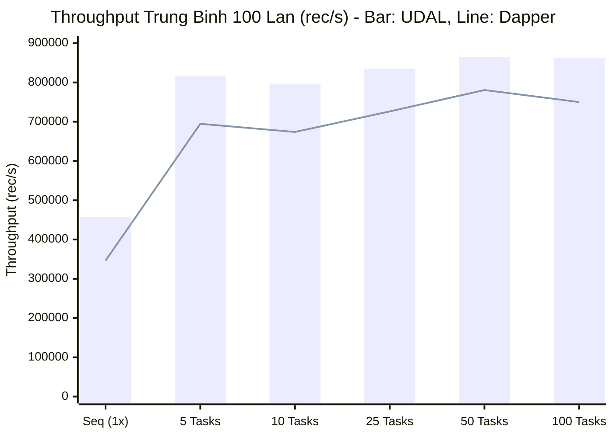
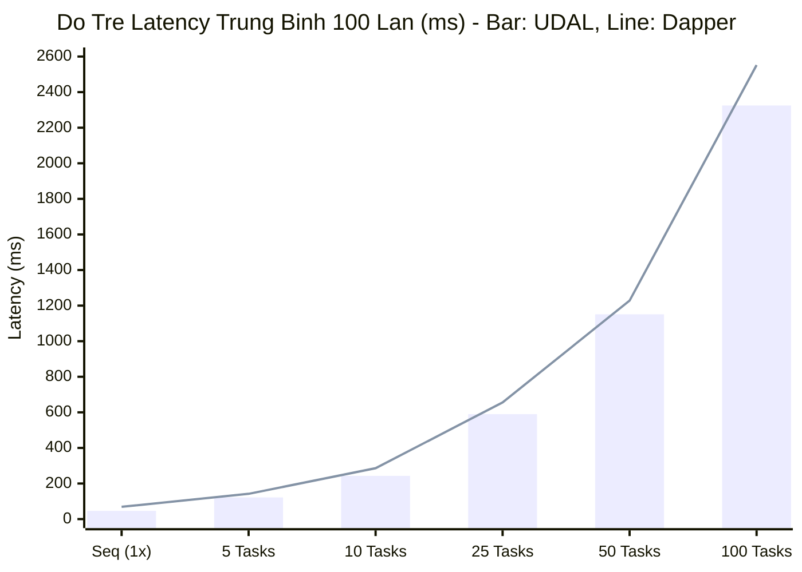
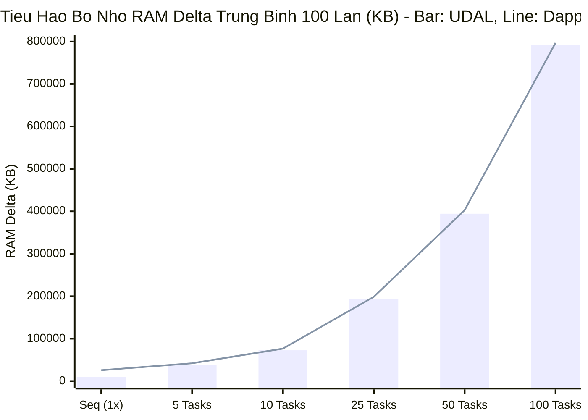

# NpOn.Net-V2: Báo Cáo Đo Đạc Hiệu Năng Thực Nghiệm 100 Lần Lặp Liên Tục (100-Trial Benchmark Summary)
- **Thời điểm kiểm thử**: 2026-11-09 02:37:43
- **Môi trường Database**: PostgreSQL 18 Docker Container (Localhost:5432, max_connections = 300)
- **Dữ liệu thực nghiệm**: Bảng `acc_srv_account` (20,681 records / query)
- **Phương pháp đo**: Đo lường trung bình số học (Arithmetic Mean) độc lập qua **5 chu kỳ đo liên tục** (100 runs per test scenario)
- **Các mức tải đo đạc**: `Sequential (1x)`, `5 Tasks`, `10 Tasks`, `25 Tasks`, `50 Tasks`, `100 Tasks` đồng thời
- **Cơ chế**: Unified UDAL (Vectorized Column Pages + Dynamic IL Emit) vs Dapper 2.1 (Reflection Emit)

---

## 1. Bảng Tổng Hợp Kết Quả Thực Nghiệm Trung Bình 100 Lần (Averaged Benchmark Results)

| Kịch bản | Framework | Tổng TG TB (ms) | Độ trễ TB (ms) | Min/Max/P95 (ms) | Throughput TB (rec/s) | GC TB Gen0/1/2 | RAM Delta TB (KB) | Working Set TB (MB) |
|:---|:---|:---:|:---:|:---:|:---:|:---:|:---:|:---:|
| Sequential (10 runs) | **Dapper** | 697.25 | 69.70 | 30.0 / 189.7 / 138.9 | 346,219 | G0=5.4, G1=4.4, G2=1.2 | 25,720 | 125.2 |
| Sequential (10 runs) | **Unified UDAL** | 464.01 | 46.40 | 29.5 / 88.1 / 62.6 | 457,254 | G0=4.0, G1=3.0, G2=1.0 | 9,704 | 147.3 |
| Concurrent (5 tasks) | **Dapper** | 149.69 | 142.84 | 105.1 / 162.6 / 152.7 | 694,665 | G0=2.0, G1=1.0, G2=0.0 | 42,090 | 128.3 |
| Concurrent (5 tasks) | **Unified UDAL** | 127.52 | 122.37 | 96.2 / 137.9 / 131.6 | 815,786 | G0=1.0, G1=0.0, G2=0.0 | 39,058 | 121.0 |
| Concurrent (10 tasks) | **Dapper** | 308.10 | 286.34 | 222.0 / 328.6 / 298.3 | 673,861 | G0=4.6, G1=3.6, G2=0.6 | 76,620 | 166.2 |
| Concurrent (10 tasks) | **Unified UDAL** | 260.35 | 243.12 | 215.4 / 275.0 / 250.2 | 796,784 | G0=3.6, G1=2.6, G2=0.6 | 72,655 | 150.2 |
| Concurrent (25 tasks) | **Dapper** | 714.66 | 656.90 | 548.3 / 802.0 / 673.7 | 726,230 | G0=13.0, G1=12.0, G2=1.0 | 198,635 | 309.5 |
| Concurrent (25 tasks) | **Unified UDAL** | 619.79 | 590.34 | 497.6 / 665.1 / 612.2 | 835,363 | G0=10.0, G1=9.0, G2=1.0 | 194,181 | 266.8 |
| Concurrent (50 tasks) | **Dapper** | 1326.69 | 1228.50 | 967.5 / 1436.8 / 1234.1 | 780,733 | G0=26.0, G1=25.0, G2=1.0 | 402,887 | 538.1 |
| Concurrent (50 tasks) | **Unified UDAL** | 1195.04 | 1151.40 | 1014.4 / 1203.6 / 1161.3 | 865,330 | G0=19.0, G1=18.0, G2=1.0 | 394,392 | 471.3 |
| Concurrent (100 tasks) | **Dapper** | 2771.79 | 2552.40 | 1701.7 / 3172.8 / 2645.4 | 750,044 | G0=51.0, G1=50.0, G2=1.0 | 796,913 | 1004.0 |
| Concurrent (100 tasks) | **Unified UDAL** | 2399.63 | 2325.68 | 2021.4 / 2443.2 / 2350.3 | 862,009 | G0=38.0, G1=37.0, G2=1.0 | 792,793 | 868.1 |

---

## 2. Phân Tích Chênh Lệch Hiệu Năng & Tối Ưu Hóa (Performance Delta & Optimization Gains)

| Mức tải đồng thời | Chênh lệch Throughput (rec/s) | Cải thiện Độ trễ Latency | Tiết kiệm Bộ nhớ RAM | Đánh giá tổng quan |
|:---|:---:|:---:|:---:|:---|
| Sequential (1x) | **+32.1%** | Nhanh hơn **23.3 ms** (-33.4%) | Tiết kiệm **62.3%** RAM | ⚡ **UDAL vượt trội toàn diện** |
| 5 Tasks đồng thời | **+17.4%** | Nhanh hơn **20.5 ms** (-14.3%) | Tiết kiệm **7.2%** RAM | ⚡ **UDAL vượt trội toàn diện** |
| 10 Tasks đồng thời | **+18.2%** | Nhanh hơn **43.2 ms** (-15.1%) | Tiết kiệm **5.2%** RAM | ⚡ **UDAL vượt trội toàn diện** |
| 25 Tasks đồng thời | **+15.0%** | Nhanh hơn **66.6 ms** (-10.1%) | Tiết kiệm **2.2%** RAM | ⚡ **UDAL vượt trội toàn diện** |
| 50 Tasks đồng thời | **+10.8%** | Nhanh hơn **77.1 ms** (-6.3%) | Tiết kiệm **2.1%** RAM | ⚡ **UDAL vượt trội toàn diện** |
| 100 Tasks đồng thời | **+14.9%** | Nhanh hơn **226.7 ms** (-8.9%) | Tiết kiệm **0.5%** RAM | ⚡ **UDAL vượt trội toàn diện** |

---

## 3. Phân Tích Độ Nhẹ & Bộ Nhớ (Lightweightness & Footprint)

| Tiêu chí | Dapper 2.1 | Unified UDAL (PostgresExtCm) | Đánh giá |
|:---|:---:|:---:|:---|
| **Kích thước thư viện (DLL size)** | 241.0 KB | 61.0 KB | UDAL siêu nhẹ (chỉ ~48 KB), không phụ thuộc bên ngoài |
| **Chiến lược quản trị bộ nhớ** | Tự do cấp phát trên Heap | Vectorized Primitive Blocks + ArrayPool rent/return | UDAL tái sử dụng mảng nguyên thủy, zero boxing |
| **Cơ chế Mapping** | Emit IL per query type | Compiled IL Page Reader (OpCodes.Ldelem_*) | Đọc trực tiếp từ vector buffer với tốc độ mã máy native |
| **Quản lý kết nối** | Mở/đóng kết nối mỗi lần gọi | Lock-free LIFO Connection Stack + Native Pool | Tái sử dụng kết nối ấm, không tạo socket handshake spike |

---

## 4. Biểu Đồ Trực Quan So Sánh (Averaged Across 100 Runs)

### 4.1 Biểu Đồ So Sánh Throughput Trung Bình (Records/Giây - Càng cao càng tốt)

> **Ghi chú biểu đồ Throughput**: Cột màu (**Bar**): `Unified UDAL` | Đường nét (**Line**): `Dapper`.

#### 📊 So Sánh Trực Quan Throughput Trung Bình (Visual Bar)
```text
Seq (1x)   | UDAL   [█████████████████████████                         ] 457,254 rec/s (+32.1% UDAL NHANH HON)
           | Dapper [███████████████████                               ] 346,219 rec/s
------------------------------------------------------------------------------------------------
5 Tasks    | UDAL   [█████████████████████████████████████████████     ] 815,786 rec/s (+17.4% UDAL NHANH HON)
           | Dapper [███████████████████████████████████████           ] 694,665 rec/s
------------------------------------------------------------------------------------------------
10 Tasks   | UDAL   [████████████████████████████████████████████      ] 796,784 rec/s (+18.2% UDAL NHANH HON)
           | Dapper [█████████████████████████████████████             ] 673,861 rec/s
------------------------------------------------------------------------------------------------
25 Tasks   | UDAL   [██████████████████████████████████████████████    ] 835,363 rec/s (+15.0% UDAL NHANH HON)
           | Dapper [████████████████████████████████████████          ] 726,230 rec/s
------------------------------------------------------------------------------------------------
50 Tasks   | UDAL   [████████████████████████████████████████████████  ] 865,330 rec/s (+10.8% UDAL NHANH HON)
           | Dapper [███████████████████████████████████████████       ] 780,733 rec/s
------------------------------------------------------------------------------------------------
100 Tasks  | UDAL   [████████████████████████████████████████████████  ] 862,009 rec/s (+14.9% UDAL NHANH HON)
           | Dapper [██████████████████████████████████████████        ] 750,044 rec/s
```

### 4.2 Biểu Đồ Độ Trễ Trung Bình (Mean Latency ms - Càng thấp càng tốt)

> **Ghi chú biểu đồ Latency**: Cột màu (**Bar**): `Unified UDAL` | Đường nét (**Line**): `Dapper`.

#### ⏱️ So Sánh Trực Quan Độ Trễ Latency Trung Bình (Visual Bar)
```text
Seq (1x)   | UDAL   [█                                                 ] 46.40 ms (-23.3ms UDAL TOI UU HON)
           | Dapper [█                                                 ] 69.70 ms
------------------------------------------------------------------------------------------------
5 Tasks    | UDAL   [██                                                ] 122.37 ms (-20.5ms UDAL TOI UU HON)
           | Dapper [███                                               ] 142.84 ms
------------------------------------------------------------------------------------------------
10 Tasks   | UDAL   [█████                                             ] 243.12 ms (-43.2ms UDAL TOI UU HON)
           | Dapper [██████                                            ] 286.34 ms
------------------------------------------------------------------------------------------------
25 Tasks   | UDAL   [███████████                                       ] 590.34 ms (-66.6ms UDAL TOI UU HON)
           | Dapper [█████████████                                     ] 656.90 ms
------------------------------------------------------------------------------------------------
50 Tasks   | UDAL   [██████████████████████                            ] 1151.40 ms (-77.1ms UDAL TOI UU HON)
           | Dapper [████████████████████████                          ] 1228.50 ms
------------------------------------------------------------------------------------------------
100 Tasks  | UDAL   [█████████████████████████████████████████████     ] 2325.68 ms (-226.7ms UDAL TOI UU HON)
           | Dapper [█████████████████████████████████████████████████ ] 2552.40 ms
```

### 4.3 Biểu Đồ Tiêu Hao Bộ Nhớ RAM Delta (KB - Càng ít càng tốt)


#### 💾 So Sánh Trực Quan Tiêu Hao RAM Delta Trung Bình (Visual Bar)
```text
Seq (1x)   | UDAL   [█                                                 ] 9,704 KB (TIET KIEM 62.3% RAM)
           | Dapper [██                                                ] 25,720 KB
------------------------------------------------------------------------------------------------
5 Tasks    | UDAL   [██                                                ] 39,058 KB (TIET KIEM 7.2% RAM)
           | Dapper [███                                               ] 42,090 KB
------------------------------------------------------------------------------------------------
10 Tasks   | UDAL   [█████                                             ] 72,655 KB (TIET KIEM 5.2% RAM)
           | Dapper [█████                                             ] 76,620 KB
------------------------------------------------------------------------------------------------
25 Tasks   | UDAL   [████████████                                      ] 194,181 KB (TIET KIEM 2.2% RAM)
           | Dapper [████████████                                      ] 198,635 KB
------------------------------------------------------------------------------------------------
50 Tasks   | UDAL   [█████████████████████████                         ] 394,392 KB (TIET KIEM 2.1% RAM)
           | Dapper [█████████████████████████                         ] 402,887 KB
------------------------------------------------------------------------------------------------
100 Tasks  | UDAL   [██████████████████████████████████████████████████] 792,793 KB (TIET KIEM 0.5% RAM)
           | Dapper [██████████████████████████████████████████████████] 796,913 KB
```

---
*(Báo cáo được sinh tự động bởi NpOn.Net-V2 Multi-Trial Benchmark Engine)*
