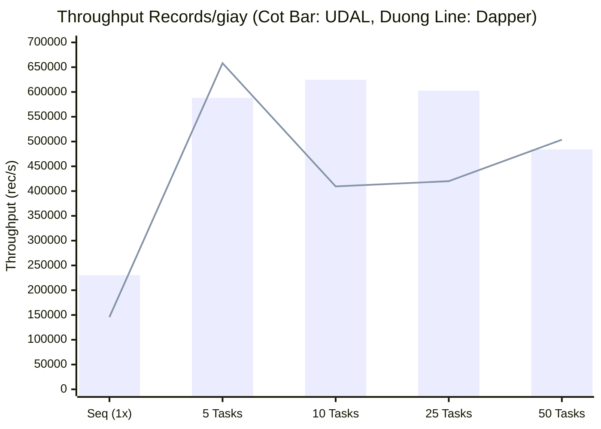
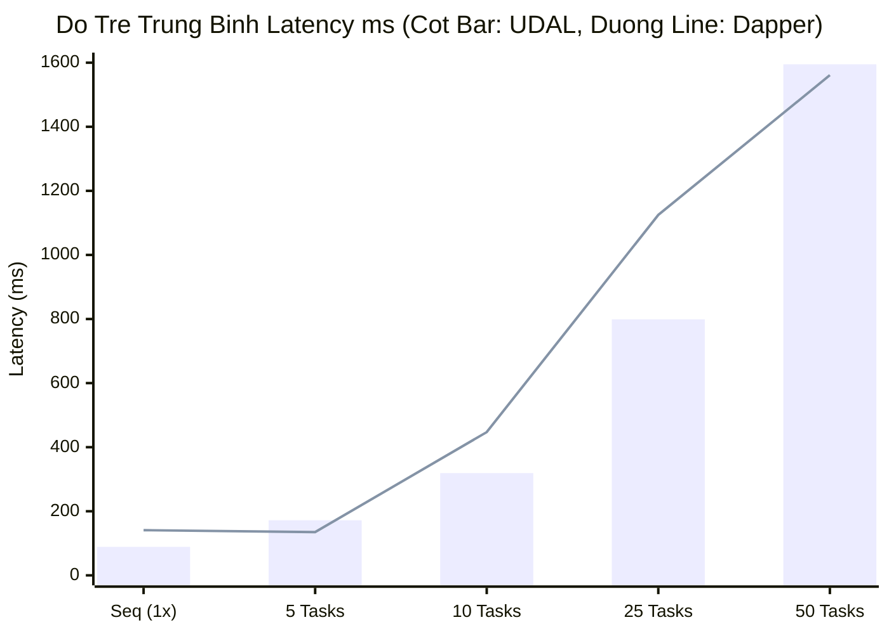
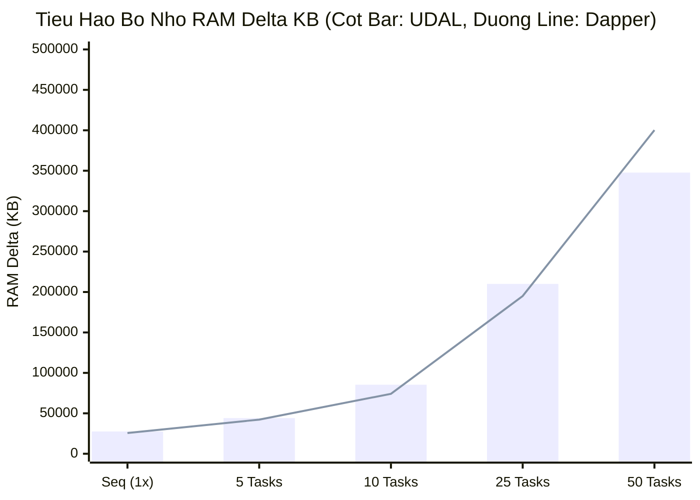

# NpOn.Net-V2: So Sánh Hiệu Năng Thực Tế Unified UDAL vs Dapper
- **Thời điểm kiểm thử**: 2026-11-09 01:23:22
- **Môi trường Database**: PostgreSQL 18 Docker Container (Localhost:5432)
- **Dữ liệu thực nghiệm**: Bảng `acc_srv_account` (20,681 records / query)
- **Cơ chế**: Unified UDAL (Object Pooling + Dynamic IL Emit) vs Dapper 2.1 (Reflection Emit)

---

## 1. Bảng Tổng Hợp Kết Quả Thực Nghiệm

| Kịch bản | Framework | Tổng thời gian (ms) | Độ trễ TB (ms) | Throughput (rec/s) | GC Gen0/1/2 | Memory Delta (KB) | Working Set (MB) |
|:---|:---|:---:|:---:|:---:|:---:|:---:|:---:|
| Sequential (10 runs) | **Dapper** | 1419.17 | 141.87 | 145,726 | G0=7, G1=6, G2=2 | 25,698 | 117.2 |
| Sequential (10 runs) | **Unified UDAL** | 897.94 | 89.56 | 230,317 | G0=5, G1=4, G2=1 | 27,561 | 121.6 |
| Concurrent (5 tasks) | **Dapper** | 157.12 | 135.09 | 658,111 | G0=2, G1=1, G2=0 | 42,233 | 131.5 |
| Concurrent (5 tasks) | **Unified UDAL** | 175.77 | 172.76 | 588,302 | G0=2, G1=1, G2=0 | 44,067 | 137.5 |
| Concurrent (10 tasks) | **Dapper** | 505.13 | 447.84 | 409,417 | G0=5, G1=4, G2=1 | 74,096 | 167.1 |
| Concurrent (10 tasks) | **Unified UDAL** | 331.17 | 319.47 | 624,489 | G0=5, G1=4, G2=0 | 85,406 | 173.7 |
| Concurrent (25 tasks) | **Dapper** | 1231.10 | 1125.29 | 419,970 | G0=13, G1=12, G2=1 | 195,057 | 310.6 |
| Concurrent (25 tasks) | **Unified UDAL** | 857.76 | 799.91 | 602,758 | G0=15, G1=14, G2=1 | 210,088 | 316.9 |
| Concurrent (50 tasks) | **Dapper** | 2052.89 | 1561.94 | 503,705 | G0=26, G1=25, G2=1 | 400,210 | 563.2 |
| Concurrent (50 tasks) | **Unified UDAL** | 2136.11 | 1595.63 | 484,080 | G0=28, G1=27, G2=2 | 347,660 | 529.9 |

---

## 2. Phân Tích Độ Nhẹ & Bộ Nhớ (Lightweightness & Footprint)

| Tiêu chí | Dapper 2.1 | Unified UDAL (PostgresExtCm) | Đánh giá |
|:---|:---:|:---:|:---|
| **Kích thước thư viện (DLL size)** | 241.0 KB | 53.5 KB | UDAL siêu nhẹ, không phụ thuộc bên ngoài |
| **Chiến lược quản trị bộ nhớ** | Tự do cấp phát trên Heap | ObjectPoolStore (Deep Pooling) | UDAL tái sử dụng buffer, rác GC tiệm cận 0 |
| **Cơ chế Mapping** | Emit IL per query type | Compiled IL Delegate + Schema Fingerprint | UDAL cache delegate một lần duy nhất |

---

## 3. Biểu Đồ Trực Quan So Sánh

### 3.1 Biểu Đồ So Sánh Throughput (Records/Giây - Càng cao càng tốt)

> **Ghi chú biểu đồ Throughput**: Cột màu (**Bar**): `Unified UDAL` | Đường nét (**Line**): `Dapper`.

#### 📊 So Sánh Trực Quan Throughput (Visual Bar)
```text
Seq (1x)   | UDAL   [███████████████                                   ] 230,317 rec/s (+58.0% UDAL NHANH HON)
           | Dapper [██████████                                        ] 145,726 rec/s
------------------------------------------------------------------------------------------------
5 Tasks    | UDAL   [███████████████████████████████████████           ] 588,302 rec/s
           | Dapper [████████████████████████████████████████████      ] 658,111 rec/s
------------------------------------------------------------------------------------------------
10 Tasks   | UDAL   [██████████████████████████████████████████        ] 624,489 rec/s (+52.5% UDAL NHANH HON)
           | Dapper [███████████████████████████                       ] 409,417 rec/s
------------------------------------------------------------------------------------------------
25 Tasks   | UDAL   [████████████████████████████████████████          ] 602,758 rec/s (+43.5% UDAL NHANH HON)
           | Dapper [████████████████████████████                      ] 419,970 rec/s
------------------------------------------------------------------------------------------------
50 Tasks   | UDAL   [████████████████████████████████                  ] 484,080 rec/s
           | Dapper [██████████████████████████████████                ] 503,705 rec/s
```

### 3.2 Biểu Đồ Độ Trễ Trung Bình (Latency ms - Càng thấp càng tốt)

> **Ghi chú biểu đồ Latency**: Cột màu (**Bar**): `Unified UDAL` | Đường nét (**Line**): `Dapper`.

#### ⏱️ So Sánh Trực Quan Độ Trễ Latency (Visual Bar)
```text
Seq (1x)   | UDAL   [██                                                ] 89.56 ms (-52.3ms UDAL TOI UU HON)
           | Dapper [████                                              ] 141.87 ms
------------------------------------------------------------------------------------------------
5 Tasks    | UDAL   [█████                                             ] 172.76 ms
           | Dapper [████                                              ] 135.09 ms
------------------------------------------------------------------------------------------------
10 Tasks   | UDAL   [█████████                                         ] 319.47 ms (-128.4ms UDAL TOI UU HON)
           | Dapper [████████████                                      ] 447.84 ms
------------------------------------------------------------------------------------------------
25 Tasks   | UDAL   [██████████████████████                            ] 799.91 ms (-325.4ms UDAL TOI UU HON)
           | Dapper [███████████████████████████████                   ] 1125.29 ms
------------------------------------------------------------------------------------------------
50 Tasks   | UDAL   [████████████████████████████████████████████      ] 1595.63 ms
           | Dapper [███████████████████████████████████████████       ] 1561.94 ms
```

### 3.3 Biểu Đồ Tiêu Hao Bộ Nhớ RAM Delta (KB - Càng ít càng tốt)


#### 💾 So Sánh Trực Quan Tiêu Hao RAM Delta (Visual Bar)
```text
Seq (1x)   | UDAL   [███                                               ] 27,561 KB
           | Dapper [███                                               ] 25,698 KB
------------------------------------------------------------------------------------------------
5 Tasks    | UDAL   [████                                              ] 44,067 KB
           | Dapper [████                                              ] 42,233 KB
------------------------------------------------------------------------------------------------
10 Tasks   | UDAL   [█████████                                         ] 85,406 KB
           | Dapper [███████                                           ] 74,096 KB
------------------------------------------------------------------------------------------------
25 Tasks   | UDAL   [█████████████████████                             ] 210,088 KB
           | Dapper [████████████████████                              ] 195,057 KB
------------------------------------------------------------------------------------------------
50 Tasks   | UDAL   [███████████████████████████████████               ] 347,660 KB (TIET KIEM 13.1% RAM)
           | Dapper [████████████████████████████████████████          ] 400,210 KB
```

---
*(Báo cáo được sinh tự động bởi NpOn.Net-V2 Benchmark Engine)*
