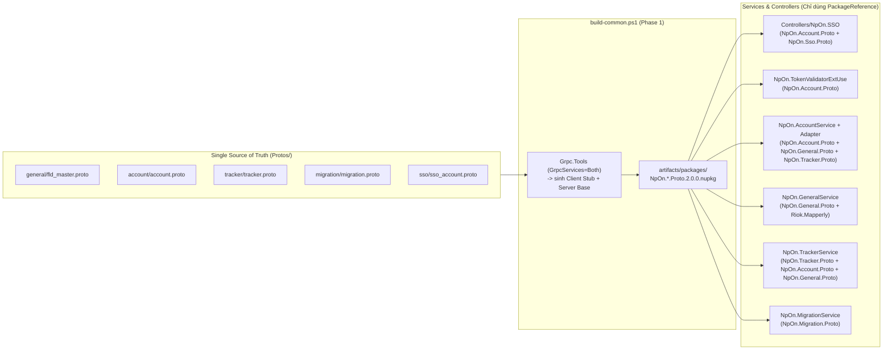
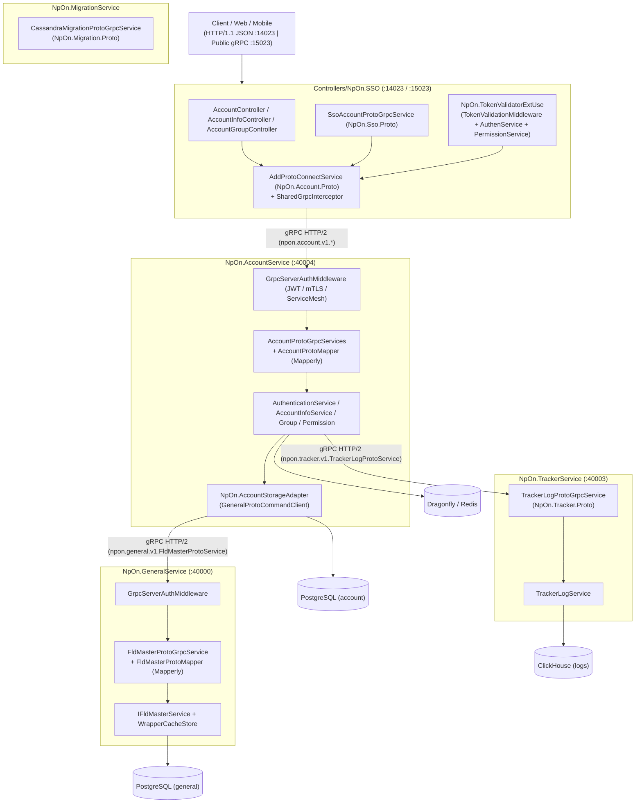
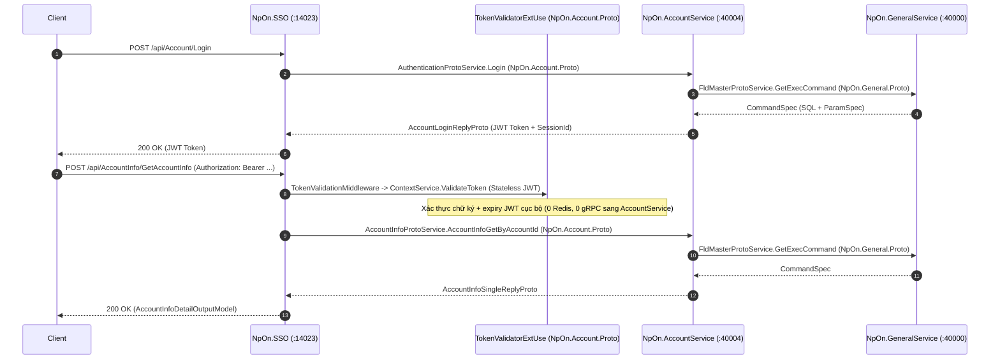

# Kiến Trúc Schema-First gRPC NuGet (`.Proto`) Toàn Hệ Thống NpOn.Net-V2

Toàn bộ các luồng giao tiếp gRPC giữa **API Gateway (`Controllers/NpOn.SSO`)**, **TokenValidator (`NpOn.TokenValidatorExtUse`)**, và **4 Microservices (`GeneralService`, `AccountService`, `TrackerService`, `MigrationService`)** đều sử dụng mô hình **Schema-First `.proto` đóng gói thành NuGet Package (`NpOn.*.Proto`)**.

Các project gọi sang service khác chỉ cần khai báo đúng 1 dòng trong `.csproj` như tham chiếu thư viện DI thông thường:
```xml
<PackageReference Include="NpOn.Account.Proto" />
```
- **Không** dùng đường dẫn tương đối (`..\..\..\..\Protos\...`) trong từng microservice/controller.
- **Không** chia sẻ chéo các DLL nội bộ (`NpOn.IAccountService`, `NpOn.IGeneralService`, `NpOn.ITrackerService`, `*ReadModel`, `*Command`), tránh kéo theo DB driver (`Npgsql`, `NpOn.CommonDb`, `HandleFlow`) sang Gateway hay các service khác.

---

## 1. Cấu trúc thư mục `Protos/` & Ma trận Package

```text
NpOn.Net-V2/
└── Protos/
    ├── ARCHITECTURE.md                       # Tài liệu kiến trúc (file này)
    ├── account/account.proto                 # Contract Authentication / AccountInfo / AccountGroup / Permission
    ├── general/fld_master.proto              # Contract FldMasterProtoService (GetExecCommand, GetExecution)
    ├── tracker/tracker.proto                 # Contract TrackerLogProtoService (PushLogs)
    ├── migration/migration.proto             # Contract CassandraMigrationProtoService (TransferTable)
    ├── sso/sso_account.proto                 # Contract SsoAccountProtoService (Public gRPC trên SSO)
    ├── NpOn.Account.Proto/NpOn.Account.Proto.csproj
    ├── NpOn.General.Proto/NpOn.General.Proto.csproj
    ├── NpOn.Tracker.Proto/NpOn.Tracker.Proto.csproj
    ├── NpOn.Migration.Proto/NpOn.Migration.Proto.csproj
    └── NpOn.Sso.Proto/NpOn.Sso.Proto.csproj
```

| NuGet Package (`artifacts/packages/`) | File `.proto` nguồn | Service Server (Implement & MapGrpc) | Consumers (Chỉ dùng `<PackageReference>`) |
|---|---|---|---|
| **`NpOn.General.Proto`** | `general/fld_master.proto` | `NpOn.GeneralService` (`FldMasterProtoGrpcService`) | `NpOn.AccountStorageAdapter` (`AccountService`), `NpOn.TrackerService` |
| **`NpOn.Account.Proto`** | `account/account.proto` | `NpOn.AccountService` (`AuthenticationProtoGrpcService`, `AccountInfoProtoGrpcService`, `AccountGroupProtoGrpcService`, `AccountPermissionProtoGrpcService`) | `Controllers/NpOn.SSO`, `NpOn.TokenValidatorExtUse`, `NpOn.TrackerService`, `NpOn.AccountService` |
| **`NpOn.Tracker.Proto`** | `tracker/tracker.proto` | `NpOn.TrackerService` (`TrackerLogProtoGrpcService`) | `NpOn.AccountService`, `NpOn.TrackerService` |
| **`NpOn.Migration.Proto`** | `migration/migration.proto` | `NpOn.MigrationService` (`CassandraMigrationProtoGrpcService`) | `NpOn.MigrationService` |
| **`NpOn.Sso.Proto`** | `sso/sso_account.proto` | `Controllers/NpOn.SSO` (`SsoAccountProtoGrpcService`) | Public gRPC Clients / Envoy |

> [!NOTE]
> Mỗi project `NpOn.*.Proto.csproj` chỉ phụ thuộc `Google.Protobuf`, `Grpc.Core.Api`, và `Grpc.Tools` (`PrivateAssets="All"`), **0 phụ thuộc** vào bất kỳ package `NpOn.*` hay DB driver nào. `build-common.ps1` tự hash cả file `.proto` và đóng gói lại khi có thay đổi.

---

## 2. Sơ đồ Cơ chế Build & Đóng gói `.Proto` NuGet



---

## 3. Sơ đồ Tương tác Runtime Toàn Hệ Thống



---

## 4. Luồng Tuần Tự Mẫu qua `.Proto` NuGet (`Login` + `GetAccountInfo` có xác thực Token)


