# NpOn.Net-V2: Sơ Đồ Quy Trình CI/CD & Cơ Chế Kiểm Định Pre-Push Hook (CI/CD Workflow Flow)

Tài liệu này mô tả chi tiết toàn bộ luồng hoạt động tự động từ máy lập trình viên (Local Developer Gate) tới hệ thống GitHub Actions Cloud và kho lưu trữ GitHub Container Registry (`ghcr.io`).

---

## 1. Sơ Đồ Toàn Diện (End-to-End Workflow Diagram)

```mermaid
flowchart TD
    Start(["Developer Commit & Gõ 'git push'"]) --> HookCheck{"[Git Hook: pre-push]<br/>Chạy ngầm tại máy Local"}
    
    subgraph LocalGate ["Tầng 1: Chốt Chặn An Toàn Local (Pre-Push Gate)"]
        HookCheck --> BuildLocal["dotnet build NpOnV2.sln -c Release"]
        BuildLocal --> TestLocal["dotnet test Test/NpOn.Core.Tests/..."]
        TestLocal --> LocalResult{"Build 0 lỗi &<br/>29/29 Unit Tests PASS?"}
        LocalResult -- "FAIL (Có lỗi)" --> AbortPush["❌ HỦY LỆNH PUSH NGAY LẬP TỨC<br/>(Không gửi code lỗi lên GitHub)"]
        LocalResult -- "PASS" --> AllowPush["✅ CHO PHÉP GIT PUSH<br/>(Đẩy code an toàn lên GitHub)"]
    end

    AllowPush --> GitHubEvent["GitHub nhận Event Push hoặc Pull Request"]

    subgraph CloudCI ["Tầng 2: GitHub Actions Automated CI (Cloud Gate)"]
        GitHubEvent --> Job1["Job 1: verify-and-test<br/>(Chạy trên Ubuntu Runner độc lập)"]
        Job1 --> CIBuild["dotnet restore & build NpOnV2.sln (Release)"]
        CIBuild --> CITest["dotnet test (Dynamic IL Emit & Mapping Tests)"]
        CITest --> CIPass{"Build 0 lỗi &<br/>29/29 Unit Tests PASS?"}
        
        CIPass -- "FAIL (Lỗi)" --> CIBreak["❌ DỪNG TOÀN BỘ PIPELINE<br/>(Báo đỏ CI, Tuyệt đối KHÔNG build Image)"]
        
        CIPass -- "PASS" --> CheckCondition{"Kiểm tra điều kiện Build Image:<br/>1. PR được MERGE?<br/>HOẶC<br/>2. Commit / PR chứa '%buildCI%' (ILIKE)?"}
        
        CheckCondition -- "KHÔNG THỎA MÃN" --> SkipBuild["Bỏ qua khâu đóng gói Container<br/>(Hoàn thành CI Test thành công)"]
        
        CheckCondition -- "THỎA MÃN (%buildCI% / Merge)" --> Job2["Job 2: build-and-push-images<br/>(needs: verify-and-test)"]
    end

    subgraph ContainerPublish ["Tầng 3: Đóng Gói & Quản Lý Kho Image (GHCR)"]
        Job2 --> DotNetPublish["dotnet publish -t:PublishContainer -c Release<br/>(Base: .NET 10 Chiseled Ubuntu siêu nhẹ)"]
        DotNetPublish --> Tagging["Gắn đồng thời 2 Tag:<br/>- 'latest' (Luôn là bản mới nhất)<br/>- 'sha-{commit_sha}' (Bản định danh duy nhất)"]
        Tagging --> PushGHCR["Đẩy 3 Microservices lên GHCR:<br/>1. ghcr.io/{owner}/account-service<br/>2. ghcr.io/{owner}/general-service<br/>3. ghcr.io/{owner}/sso-controller"]
        
        PushGHCR --> Job3["Job 3: Prune Old Packages<br/>(actions/delete-package-versions@v5)"]
        Job3 --> RetainPolicy["🧹 CHÍNH SÁCH LƯU TRỮ TỐI GIẢN:<br/>Chỉ giữ lại:<br/>1. Bản 'latest' (Mới build)<br/>2. Đúng 1 bản liền kề trước đó (Rollback)<br/>Xóa sạch toàn bộ bản từ thứ 3 trở đi!"]
    end

    RetainPolicy --> Done(["Hoàn tất Deployment Pipeline thành công!"])

    %% Style nodes
    style Start fill:#1e293b,stroke:#38bdf8,stroke-width:2px,color:#fff
    style LocalGate fill:#0f172a,stroke:#64748b,stroke-width:1px,color:#fff
    style CloudCI fill:#0f172a,stroke:#64748b,stroke-width:1px,color:#fff
    style ContainerPublish fill:#0f172a,stroke:#64748b,stroke-width:1px,color:#fff
    style LocalResult fill:#334155,stroke:#f59e0b,stroke-width:2px,color:#fff
    style CIPass fill:#334155,stroke:#f59e0b,stroke-width:2px,color:#fff
    style CheckCondition fill:#334155,stroke:#38bdf8,stroke-width:2px,color:#fff
    style AbortPush fill:#450a0a,stroke:#ef4444,stroke-width:2px,color:#fff
    style CIBreak fill:#450a0a,stroke:#ef4444,stroke-width:2px,color:#fff
    style AllowPush fill:#064e3b,stroke:#10b981,stroke-width:2px,color:#fff
    style Done fill:#064e3b,stroke:#10b981,stroke-width:2px,color:#fff
```



---

## 2. Chi Tiết Các Chốt Chặn Kỹ Thuật

### 2.1 Chốt chặn 1: Git Hook Local (`.githooks/pre-push`)
- **Tập tin**: `.githooks/pre-push`
- **Mục đích**: Bảo vệ nhánh nguồn, chặn đứng code lỗi ngay tại máy trạm trước khi gửi lên internet.
- **Lệnh kích hoạt (1 lần duy nhất)**:
  ```powershell
  .\setup-hooks.ps1
  # Hoặc lệnh Git gốc:
  git config core.hooksPath .githooks
  ```
- **Hành vi khi vi phạm**: Nếu `dotnet build` fail hoặc có 1 unit test fail, tiến trình trả về `exit 1` và `git push` bị hủy ngay lập tức.

### 2.2 Chốt chặn 2: Cloud CI Test Gate (`verify-and-test`)
- **Tập tin**: `.github/workflows/build-ci.yml`
- **Môi trường**: GitHub Actions Runner (`ubuntu-latest`).
- **Mục đích**: Đảm bảo môi trường build sạch (Clean Room Environment) không bị ảnh hưởng bởi cache cục bộ.
- **Ràng buộc**: Job `build-and-push-images` khai báo `needs: verify-and-test`. Nếu Job 1 thất bại, Job 2 **vĩnh viễn không được kích hoạt**.

### 2.3 Bộ Lọc Điều Kiện Tương Tự SQL ILIKE (`%buildCI%`)
Biểu thức kiểm tra không phân biệt hoa thường đối với commit message hoặc tiêu đề Pull Request:
```yaml
if: |
  github.event_name == 'workflow_dispatch' ||
  (github.event_name == 'pull_request' && github.event.pull_request.merged == true) ||
  contains(toLower(github.event.head_commit.message), 'buildci') ||
  contains(toLower(github.event.pull_request.title), 'buildci')
```
- **Ví dụ Commit hợp lệ kích hoạt build**:
  - `git commit -m "feat: [buildCI] fix token validation"`
  - `git commit -m "update driver buildci"`
  - `git commit -m "release: BUILDCI version 2.0"`
  - Merge bất kỳ Pull Request nào vào nhánh `main`, `master`, `driver`.

### 2.4 Chính Sách Quản Lý Image Tại GitHub Packages (`ghcr.io`)
- **Tên Image chuẩn OCI**:
  - `ghcr.io/<repo-owner>/account-service`
  - `ghcr.io/<repo-owner>/general-service`
  - `ghcr.io/<repo-owner>/sso-controller`
- **Quy tắc Tag**:
  - Tag `latest`: Luôn trỏ tới phiên bản vừa build thành công mới nhất.
  - Tag `sha-<commit_sha>`: Định danh hash commit tương ứng để dễ dàng rollback.
- **Quy tắc Dọn dẹp (`min-versions-to-keep: 2`)**:
  - Hệ thống tự động xóa bỏ toàn bộ các image từ phiên bản thứ 3 trở về trước, chỉ lưu giữ đúng **2 image** (Bản `latest` hiện tại và đúng 1 bản dự phòng liền kề).

